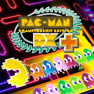

<div align=center>



</div>
<h1 align=center>pacman-nx installer</h1>

The installer page of [pacman-nx](https://github.com/ChanseyIsTheBest/pacman-nx), the native Nintendo Switch port of
PAC-MAN Championship Edition DX (Xbox 360): **https://chanseyisthebest.github.io/pacman-nx-installer/**

You give it your own copy of the game (its Xbox 360 package, or a folder you extracted it into), with the DLC package if you
have it, and it gives you a zip ready to extract into `sdmc:/switch/`. Everything runs in your browser: the game files never
leave your computer.

## What it does

1. Finds the game in what you chose: the package (`Content/<profile>/58410A8C/000D0000`, read in place by `lib/stfs.js`;
   nothing is extracted to disk), or a folder with `default.xex`. The DLC package of the game (content type 2 of title
   `58410A8C`) is picked up too, wherever it is among the chosen files.
2. Identifies the game by the SHA-256 of `default.xex` and picks its build from `release/manifest.json`.
3. Downloads that build's NRO and checks its SHA-256.
4. Makes the shaders of the deko3d renderer. 13 of the game's 17 shaders are Direct3D shader containers in `default.xex`,
   which is decrypted and unpacked in the page (`lib/xex.js`, with libmspack's LZX decoder in WebAssembly). Each container
   goes through pacman-nx's native chain: Renut's XenosRecomp translates it to HLSL (`wasm/renut_hlsl`), the alpha-tested pixel
   shaders get their early alpha copy (`lib/early_alpha.js`), DXC compiles it to SPIR-V (`wasm/dxc_web`), SPIRV-Cross turns that
   into GLSL (`wasm/spirv_cross`), banjo-nx's passes trim it (`lib/deko3d_glsl.js`) and `lib/deko3d_package.js` packs them. The
   package must match the tested one (its SHA-256 is in `release/manifest.json`). The game makes the other 4 at run time with
   its own shader compiler, so they are in none of its files: those 4 are built into the NRO. The console compiles each shader
   with uam the first time the game uses it and keeps the result.
5. Streams the zip to disk through the service worker.

The zip holds `pacman-nx/pacman-nx.nro` with its `LICENSES.txt`, `deko3d_glsl.bin`, the game in `game_root/` and, if you chose
it, the DLC in `dlc/` (the game installs it at its first start). The update zip holds the NRO, its licenses and the shaders
(and the DLC if you chose it). Neither holds `pacman.toml`: the game writes it at its first start, so an update never
overwrites your settings.

The page and the downloaded program are cached by the service worker: after the first visit it also works without a
connection.

## Layout

| Path | Contents |
|---|---|
| `index.html`, `app.js` | The page and its interface (English and Japanese, `lib/i18n.js`) |
| `worker.js` | Builds the package off the main thread |
| `sw.js` | Offline cache and the download stream |
| `lib/` | Package reader (STFS), XEX reader, the deko3d shaders (`shaders.js`, `deko3d.js`, `early_alpha.js`, `deko3d_glsl.js`, `deko3d_package.js`), zip writer |
| `wasm/` | WebAssembly builds of the shader translator, DXC, SPIRV-Cross and the LZX decoder |
| `renut_shader_common.h` | Renut's translator's HLSL header (from `app/thirdparty/reblue-XenosRecomp/XenosRecomp` of pacman-nx) |
| `release/` | The list of builds and the licenses of the NRO |
| `test/` | Node scripts that run the same code as the page |

`wasm/renut_hlsl.*` (Renut's translator with pacman-nx's `tools/renut_hlsl_frontend.cpp`) and `wasm/spirv_cross.*` are
built with `wasm/src/deko3d/build_wasm_deko3d.sh`. `wasm/dxc_web.*` is the WebAssembly DXC of
[nfsmw-nx-installer](https://github.com/StevensND/nfsmw-nx-installer); see [NOTICES.md](NOTICES.md).

## Deployment

The NRO is not stored here: it is the `pacman-nx.nro` asset of a release of the pacman-nx repository of the same owner. The
workflow in `.github/workflows/deploy.yml` downloads it from the latest release, checks its SHA-256 against the list and
publishes the page on GitHub Pages. It runs on every push to `main`; after publishing a new release, run it by hand from the
Actions tab.

To publish a new build, this script writes the build's entry in `release/manifest.json` from your own copy of the game, with
the page's code:

```sh
node test/release_node.mjs <game package or folder> <pacman-nx.nro> --version 1.0.0 --write
```

It leaves the page's `deko3d_glsl.bin` in `release/` (not committed): test the NRO with exactly that file next to it.

## Testing locally

Put `pacman-nx.nro` in `release/` and serve the folder (any static server works; this one sets the right MIME types):

```sh
python serve.py 8193
```

Then open http://127.0.0.1:8193/. The same code runs in Node:

```sh
node test/package_node.mjs pacman-nx.zip <game package or folder> [<DLC package> ...]
node test/package_node.mjs pacman-nx-update.zip <game package or folder> --update
node test/deko3d_node.mjs <game package or folder> [<pacman-nx's out/deko3d_shaders/glsl_opt>] [--out deko3d_glsl.bin]
node test/texts_node.mjs
```

## License

GPL-3.0 (see [LICENSE](LICENSE)). Third-party components are listed in [NOTICES.md](NOTICES.md). The page is built on
[katamari-nx-installer](https://github.com/ChanseyIsTheBest/katamari-nx-installer), itself built on
[futari-nx-installer](https://github.com/ChanseyIsTheBest/futari-nx-installer),
[sa2-nx-installer](https://github.com/ChanseyIsTheBest/sa2-nx-installer) and
[nfsmw-nx-installer](https://github.com/StevensND/nfsmw-nx-installer) by StevensND.

PAC-MAN is a trademark of Bandai Namco Entertainment Inc.; the icon artwork is © Bandai Namco. This project is not affiliated
with or endorsed by Bandai Namco, Nintendo or Microsoft.
